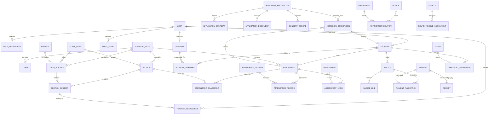
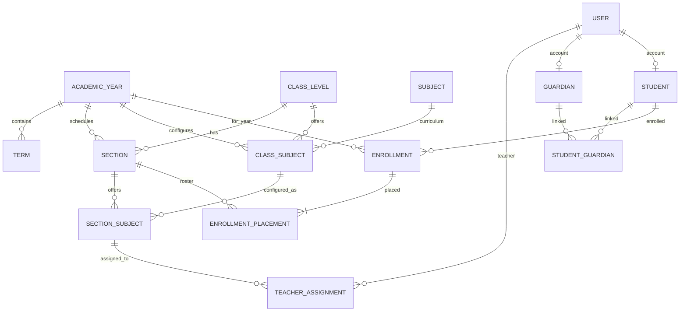

# ERP Data Model Design: Overall Map and M2 Detail

**Status:** Design reviewed and accepted as the M2 starting baseline; initial database foundation implemented, pending database integration validation and API/authorization implementation  
**Scope:** Overall ERP entity map, detailed M2 academic/student model, constraints, and integration rules  
**Implementation:** Initial M2 entities and migration now exist in `apps/api`; this document remains the design reference and includes requirements not yet implemented  
**Architecture:** One school, PostgreSQL 16, NestJS modular monolith, web client now, mobile client later

This design follows [ADR-001](./adr/ADR-001-monorepo-and-foundation.md), [product scope](./01_PRODUCT_AND_PROCESS_SCOPE.md), [module workflows](./02_MODULE_REQUIREMENTS_AND_WORKFLOWS.md), [database rules](./04_DATA_MODEL_AND_DATABASE_RULES.md), and [API contracts](./05_API_AND_INTEGRATION_CONTRACTS.md).

The goal is to map the full ERP enough to protect module boundaries and preserve workflows, while implementing only M2 first. Later module entities shown here are planning-level proposals; their owners must refine and approve them before implementation. Open decisions in section 8 need team answers before the M2 migration is written.

## 1. Design principles

1. **Model the school's real lifecycle.** Academic setup precedes admissions; approved admissions create student, guardian links, and an enrollment; downstream modules use those records rather than re-entering student identity.
2. **Keep historical facts stable.** An academic year's section, subject offering, teacher assignment, enrollment, attendance, assessment, invoice, receipt, and audit history must remain interpretable after later changes.
3. **Separate identity from login.** A student or guardian may exist without a user account. `users` represents credentials and authorization; domain tables represent school records. Link a domain person to a user only when an account exists.
4. **Use explicit relationships.** Guardianship, enrollment, teacher assignment, payments, and transport are relationships with their own dates/status/metadata, not comma-separated IDs or duplicated text.
5. **Make repeated requests safe.** Admission conversion, payment/provider events, receipts, promotion, and other retryable writes need database uniqueness and transaction/idempotency controls.
6. **Protect children's data.** Collect the minimum necessary data, scope every read/write on the server, keep documents private, and keep sensitive values out of logs and broad audit metadata.
7. **Keep the backend client-independent.** The NestJS API owns validation, business rules, and access decisions. Web and future mobile clients consume the same versioned API and shared contracts.
8. **Preserve the single-school architecture.** Do not add tenant IDs, tenant middleware, school selectors, or multi-school row-level security. A school profile can store this school's settings but is not a tenant boundary.

## 2. Overall ERP relationship map

This is the proposed cross-module map. It shows entity ownership and workflow dependencies, not a commitment to build every module now.

`USER`, `ROLE_ASSIGNMENT`, and `AUDIT_EVENT` already belong to M0. The M2 diagram below defines the first domain slice. The later-module entity names in this figure are conceptual and must not be used as an implementation contract until their requirements are reviewed.

## 3. Module ownership and boundaries

| Module                      | Owns / is source of truth for                                                                                                                                                                                       | References other modules through                                                                                                                    |
| --------------------------- | ------------------------------------------------------------------------------------------------------------------------------------------------------------------------------------------------------------------- | --------------------------------------------------------------------------------------------------------------------------------------------------- |
| M0 platform                 | `users`, `role_assignments`, `auth_sessions`, `audit_events`, platform configuration                                                                                                                                | User IDs, permission contracts, audit service; does not own student/guardian records.                                                               |
| M2 academic/student masters | `academic_years`, `terms`, `class_levels`, `sections`, `subjects`, curriculum/section subject offerings, teacher assignments, `students`, `guardians`, student-guardian links, `enrollments`, enrollment placements | M0 user IDs for teacher/optional person login links; other modules reference enrollment/student IDs.                                                |
| M1 admissions               | Applications, application guardians, private document metadata, verification and consent records, review/decision history, conversion idempotency                                                                   | M2 creates canonical student/guardian/enrollment records as part of an approved conversion. M1 must not maintain a second permanent student master. |
| M3 fees/payments            | Fee heads/plans, concessions, invoices/lines, payment attempts/provider events, allocations, receipts, refunds/reconciliation                                                                                       | Student/enrollment IDs from M2; application/conversion reference from M1 where an admission fee is configured.                                      |
| M4 attendance               | Sessions, attendance records, correction history                                                                                                                                                                    | Enrollment and section/teacher assignment IDs from M2.                                                                                              |
| M5 communication            | Notices, recipient snapshots, delivery attempts/status, preferences                                                                                                                                                 | User/person/enrollment relationships from M0/M2; delivery provider IDs are not user identity.                                                       |
| M6 homework                 | Assignments, attachments, submissions                                                                                                                                                                               | Section/subject/teacher assignment and enrollment IDs from M2.                                                                                      |
| M7 exams/report cards       | Assessment setup, grade scales, marks, review/publication history, generated report metadata                                                                                                                        | Enrollment, section, subject, and teacher assignment IDs from M2.                                                                                   |
| M8 transport                | Vehicles, routes, stops, route capacity, effective-dated student assignments                                                                                                                                        | Student/enrollment and guardian contact references from M2; optional fee linkage through M3 contracts.                                              |

Each module owns its tables and migrations. Cross-module modules reference IDs and use agreed service/API contracts; they must not write directly into another module's tables to avoid that module's validations, authorization, audit, and invariants.

## 4. Detailed M2 model

### 4.1 Entity relationship view

### 4.2 Proposed tables and responsibilities

Names below are conceptual. Use UUID primary keys, PostgreSQL foreign keys, and the repository's existing TypeORM naming style. Existing M0 tables use lower-case plural table names and camelCase column names; new entity definitions and migrations should remain consistent unless a separate naming-standard decision is approved.

| Table                       | Purpose and key fields                                                                                                                                                                     | Important rules                                                                                                                                                                                                                                                                  |
| --------------------------- | ------------------------------------------------------------------------------------------------------------------------------------------------------------------------------------------ | -------------------------------------------------------------------------------------------------------------------------------------------------------------------------------------------------------------------------------------------------------------------------------- |
| `academic_years`            | School year label/code, `startsOn`, `endsOn`, lifecycle status (`PLANNED`, `ACTIVE`, `CLOSED`), created/updated timestamps.                                                                | Unique year code; `startsOn <= endsOn`; at most one active year. Closing a year does not delete its records. Do not require academic years to be calendar years.                                                                                                                 |
| `terms`                     | A term/semester within an academic year: year ID, name/code, sequence, start/end dates, status.                                                                                            | Unique `(academicYearId, sequence)` and `(academicYearId, code)`; date range must be within year and start no later than end.                                                                                                                                                    |
| `class_levels`              | Stable grade/class labels such as Nursery, Kindergarten, Grade 1..12; code, display name, sort order, enabled state.                                                                       | Unique stable code and sort order. This is a grade level, not a section and not an academic-year roster.                                                                                                                                                                         |
| `sections`                  | A class-level instance in an academic year, such as Grade 5 / Section A: year ID, class-level ID, name/code, optional capacity, status.                                                    | Unique `(academicYearId, classLevelId, code)`; capacity positive if set. The same label can recur in a later year.                                                                                                                                                               |
| `subjects`                  | Reusable subject catalog: code, display name, status.                                                                                                                                      | Unique code. Do not put year-specific teacher, class, or grading rules here.                                                                                                                                                                                                     |
| `class_subjects`            | Subject offered to a class level in a specific year: year ID, class-level ID, subject ID, required/elective flag, optional sequence.                                                       | Unique `(academicYearId, classLevelId, subjectId)`. This preserves curriculum changes across years.                                                                                                                                                                              |
| `section_subjects`          | Connects a section to a configured class subject.                                                                                                                                          | A section may only use a class subject configured for the same year and class level. Enforce with composite foreign keys or an equivalent database-safe constraint; do not rely only on the UI. Unique section/class-subject pair.                                               |
| `teacher_assignments`       | Teacher user ID, section-subject ID, effective start/end dates.                                                                                                                            | The database links an assignment to a user and prevents overlapping assignments for the same teacher/offering. The future service must also require an enabled account with the approved teacher role and validate dates against the offering. Preserve previous assignments.    |
| `class_teacher_assignments` | Effective-dated homeroom/class-teacher responsibility: section ID, teacher user ID, start/end dates, and optional reason.                                                                  | The database prevents overlapping class-teacher assignments for a section and limits it to one current assignment. The future service must require an enabled account with the teacher role. This is distinct from a subject-teacher assignment and from the user's global role. |
| `students`                  | Permanent student identity: unique school admission/student number, name fields, date of birth and only other approved minimum attributes, lifecycle status, optional user ID, timestamps. | Unique immutable school number; optional `userId` unique and FK to M0 users. Public student registration is not implied. Avoid copying credentials into this record. Sensitive fields need purpose/access/retention decisions.                                                   |
| `guardians`                 | Canonical parent/guardian identity/contact record, optional linked user ID, status and minimum necessary contact data.                                                                     | Optional `userId` is unique and FK to M0 users. One guardian can be linked to multiple students. Do not use email or phone alone as an automatic identity merge key.                                                                                                             |
| `student_guardians`         | Join record: student ID, guardian ID, relationship label, primary-contact flag, pickup permission if approved, communication eligibility, effective dates.                                 | Unique active student/guardian relationship; at most one active primary guardian per student. Relationship/permissions are server-validated and changes audited. Keep legal consent in M1 consent records, not inferred from this link.                                          |
| `enrollments`               | One student's enrollment in one academic year: student ID, year ID, enrollment status, enrolled/exited dates, source/reference to M1 conversion if applicable.                             | Unique `(studentId, academicYearId)` per the current product rule; student and year must exist. Enrollment status is independent from account/login status. A new year's promotion creates a new enrollment rather than overwriting the previous year.                           |
| `enrollment_placements`     | Effective-dated section/class placement history: enrollment ID, section ID, starts/ends dates, reason, recorded-by user ID.                                                                | Section year must match enrollment year; placement periods for one enrollment cannot overlap; only one current placement. Section transfer closes a placement and adds a new one; it does not rewrite historical attendance or marks.                                            |

The product documentation calls a school number an “admission number.” Decide whether that number is assigned during application approval or only when a student is enrolled. This design uses a unique permanent student number assigned exactly once during the admissions-to-enrollment conversion; applications keep their own separate application number.

### 4.3 M2 lifecycle behavior

1. An administrator creates academic years, terms, class levels, sections, subjects, year-specific class curriculum, and section subject offerings.
2. Authorized staff assign teachers to section/subject offerings for an effective period. A change preserves the old assignment record.
3. M1 approval creates or links a canonical student and guardian, links them through `student_guardians`, and creates the student's first `enrollments` row plus its initial placement in one transaction. Repeating the same approved conversion must return the same records rather than create duplicates.
4. A student may have no current enrollment while archived or between years. Do not delete the student when they leave the school.
5. Promotion creates an enrollment for the next academic year and its initial placement. It does not mutate the previous enrollment, attendance, fee ledger, or report card. A promotion batch must be safely resumable and report per-student failures.
6. A section/class change during a year is a dated placement transition. The historical roster remains available to attendance, marks, and reports.
7. Withdrawal or transfer-out changes enrollment/lifecycle state with an effective date and reason. It must not erase historical records. A transfer within the school may create a new placement; a transfer to another school closes the enrollment.
8. Guardian or teacher access is computed from current, approved relationships and the requested record's effective context. A valid role alone is not permission to read all students.

## 5. Cross-module workflow and integrity rules

### Admissions to enrollment (M1 -> M2)

- An application is not a student. Drafts and rejected applications must not create active student enrollments.
- Keep a unique application number separate from the student's permanent school number.
- Store application guardians and consent as application-scoped records while the application is pending. On approval, link/create canonical M2 guardian records through an explicit reviewed matching process; do not silently merge people based only on matching contact data.
- Conversion must run transactionally: claim a unique conversion/idempotency key, create/link student and guardians, create enrollment and first placement, write conversion/audit state, and mark the application converted. A retry must not duplicate any of these.
- If configured admission charges are generated, M1 requests an M3-owned invoice operation through an agreed API/service contract. M1 must not insert invoice rows directly.

### Later module references

- **Fees:** invoices reference student and, when needed for historical context, enrollment. Invoice lines preserve description/amount snapshots. Payments and provider events have unique provider identifiers; allocations support partial settlement; receipts have unique business numbers. Store integer paise or approved fixed-precision numeric values, never binary floating point.
- **Attendance:** a session belongs to a section/subject/teacher assignment and date/period. Attendance records reference enrollment, so a section transfer cannot change old attendance. Enforce one record per session/enrollment and keep corrections as traceable events or versioned changes.
- **Exams/report cards:** assessments belong to academic year/term and section/subject. Marks reference the student's enrollment and assessment; enforce uniqueness at the approved assessment/enrollment/subject grain. Preserve submission, approval, and publication history.
- **Communication/homework:** target and authorize recipients through current enrollment/guardian/teacher relationships. For sent notices and published results, retain a minimal recipient/delivery snapshot so later relationship changes do not erase delivery evidence. Attachments use private file metadata and per-request authorization.
- **Transport:** route/stop/vehicle and student route assignments are effective-dated. Enforce capacity and active assignment rules in the database/service; do not store a current route only as a free-text student field.
- **Audit:** continue using the M0 append-only audit event stream for sensitive actions. Domain tables remain the source of current state; audit events record who changed what and when. Do not put passwords, tokens, documents, or unnecessary child/guardian data in metadata.

## 6. Constraints, indexes, and data types

Apply these rules to the M2 schema and carry them into later modules:

- Technical primary keys are UUIDs, consistent with the M0 entities. Business numbers are separate unique columns and never used as foreign keys.
- Use `date` for birthdays, school-year bounds, term bounds, and effective dates; use `timestamptz` for instants such as created/updated/audit times. Store and compare instants in UTC.
- Add foreign keys for every relationship. Choose delete behavior explicitly: restrict historical academic/financial references; cascade only truly dependent join rows when policy allows. Never cascade-delete student history.
- Add check constraints for valid date ranges, positive capacities, bounded values, and allowed state transitions where a static DB constraint can express them.
- Add unique constraints for business keys and idempotency keys. Use partial unique indexes for rules such as one active academic year, one active primary guardian per student, and one active enrollment placement.
- Effective-dated teacher and enrollment-placement ranges must not overlap. The M2 migration uses PostgreSQL `btree_gist` exclusion constraints so this remains true under concurrent writes.
- Index foreign keys and actual query paths: active academic year, year/class sections, section-subject-teacher roster, student number/name lookup, guardian-to-student lookup, year/status enrollment lists, and effective placements. Avoid adding an index to every field without a query need.
- Use explicit enum/check constraints for stable lifecycle states. Do not overload a single `status` field to represent account state, student state, enrollment state, and application state.
- Keep canonical tables normalized. JSONB is appropriate for bounded metadata or provider payloads with a documented purpose, not for core entities, permissions, money, or relationships.
- Use migrations only. TypeORM `synchronize` remains disabled. Migrations are reviewed, applied to a clean PostgreSQL database in CI, then rehearsed against staging before production.
- No physical deletion of audit events, issued receipts, settled payment history, published report history, or student history. Apply the approved correction, retention, and privacy workflow instead.

## 7. Implementation boundaries and migration sequence

This is a design sequence, not permission to skip review gates:

1. Resolve the decisions below and review this design with the team, especially academic lifecycle, admissions conversion, guardian identity, and transfer history.
2. Agree M2 API contracts and permissions for academic masters, teacher assignment, student/guardian listing, enrollment, promotion, and transfer.
3. The first M2 database slice is implemented in `apps/api/src/academic/entities` and migration `2026103100000-M2AcademicStudentFoundation`. Continue with M2 services, endpoints, permissions, and tests only after their contracts are reviewed. Keep M1 admissions and later module tables out of the M2 migration.
4. Apply the M2 migration to an empty PostgreSQL database and verify constraints with positive and negative integration tests. Review down migration or documented forward-fix before merge.
5. Build the web UI against the stable API. Keep the API independent of browser/session assumptions so the later mobile app can use the same contract.
6. M1 later calls the agreed M2 conversion operation; M3/M4/M6/M7/M8 reference M2-owned IDs only through module contracts.

Before a migration is merged, CI should prove it applies to a clean PostgreSQL database; tests should exercise unique/FK/date constraints and the important enrollment/placement rules. CI success is not a substitute for a reviewer checking schema changes or staging recovery.

## 8. Decisions required before M2 migration

These are product/data decisions, not implementation details to guess in code:

1. **Academic terminology:** Are “class” and “grade” interchangeable in the UI? Which pre-primary names and class codes are used? Is the school calendar allowed to have overlapping academic years?
2. **Academic year lifecycle:** Can administrators edit dates after an academic year becomes active? What exact action closes a year, and can a closed year be reopened?
3. **Terms:** Are terms semesters, quarters, or school-defined periods? Can a term's dates overlap another term?
4. **Subjects:** Are electives/groups needed in the first M2 release? Can the same subject code have a different display name by language or by year?
5. **Teacher account relationship:** Must every teacher have a `users` account before assignment, or can assignments be staged before account provisioning?
6. **Student number:** Is the permanent number assigned at approval, first enrollment, or another point? Is it sequential, year-prefixed, or opaque? Must numbers ever be reused? They should not be.
7. **Guardian accounts:** Can one guardian login link to multiple guardian profiles, or should one canonical guardian profile map to one user? How are shared custody, multiple primary contacts, and notification preferences represented?
8. **Enrollment cardinality:** Confirm one enrollment per student per academic year. How are mid-year class changes represented and what is the policy for repeating a year or rejoining after withdrawal?
9. **Transfer semantics:** Distinguish section change, class change, transfer within this school, and leaving the school. Define effective date, reason, and approval requirements.
10. **Sensitive student attributes:** Which identity, demographic, health, emergency, and contact fields are actually needed for MVP? Define field-level access, retention, correction, and optional Aadhaar policy before storing them.
11. **Existing student import:** Define duplicate detection, external/source identifier, error reporting, audit, and safe re-run behavior before importing spreadsheet records.
12. **Class capacity:** Is capacity enforced at enrollment time, advisory only, or principal-approved override? Define the override audit and permissions.

## 9. Review checklist

- [ ] M2 tables and relationships match approved workflows in docs 01 and 02.
- [ ] M1 can convert an approved application into student, guardian links, enrollment, and first placement exactly once.
- [ ] M3/M4/M6/M7/M8 can reference stable M2 IDs without owning or rewriting M2 records.
- [ ] Year-specific class/subject/teacher/section/placement history remains correct after promotion, transfer, or correction.
- [ ] Role permissions and object scopes are specified for each operation; parent and teacher access is relationship-scoped.
- [ ] Required fields are justified; child/guardian sensitive fields have purpose, access, and retention rules.
- [ ] Keys, foreign keys, checks, uniqueness, indexes, delete behavior, and idempotency are reviewed.
- [ ] Transaction boundaries and retry behavior are explicit for admissions conversion and promotion.
- [ ] Migration and rollback/forward-fix plan is reviewed by a second developer and tested against PostgreSQL.
- [ ] API contracts remain reusable by web now and mobile later.

## 10. Recommendation

Approve the overall map as a planning baseline, answer the M2 decisions with the product/team, then implement only the M2 slice. Do not build all ERP tables up front: later modules will refine their own workflows, and premature detailed schemas would create rework. Do not build M2 in isolation either: its permanent IDs, lifecycle history, and conversion contract must support admissions, fees, attendance, homework, exams, and transport without allowing those modules to duplicate or mutate M2-owned records.

## 11. Initial API implementation status

The first M2 API slice is implemented under `apps/api/src/academic` and is client-independent. All routes require a bearer-authenticated account and the listed permission; there are no public student or academic write routes.

| Route family                                                                                              | Operations                                                                                 | Permission / scope                                                                                                                                                         |
| --------------------------------------------------------------------------------------------------------- | ------------------------------------------------------------------------------------------ | -------------------------------------------------------------------------------------------------------------------------------------------------------------------------- |
| `/api/v1/academic/years`                                                                                  | List, create, update, activate, close                                                      | `academic:read` to list; `academic:write` to change. Only one year can be active; a new year cannot activate before the current one is closed.                             |
| `/api/v1/academic/terms`                                                                                  | List by year, create, update                                                               | `academic:read` / `academic:write`; dates must fit the selected academic year.                                                                                             |
| `/api/v1/academic/class-levels`, `/sections`, `/subjects`                                                 | Paginated list, create, update                                                             | `academic:read` / `academic:write`; records with historical references are deactivated or retained, not deleted.                                                           |
| `/api/v1/academic/years/:yearId/class-levels/:classLevelId/subjects`                                      | List/add curriculum subjects                                                               | `academic:read` / `academic:write`; year/class/subject consistency is checked in the service and database.                                                                 |
| `/api/v1/academic/sections/:sectionId/subjects`                                                           | List/add subjects offered in a section                                                     | `academic:read` / `academic:write`; section and curriculum context must match.                                                                                             |
| `/api/v1/academic/teacher-assignments`, `/class-teacher-assignments`                                      | List, create, end assignment                                                               | `academic:read` / `academic:write`; creation requires an active account with the `TEACHER` role. Teachers can view only their own assignments in the active academic year. |
| `/api/v1/students`                                                                                        | Paginated list/search, create, get, update, scoped enrollment history                      | `student:read` / `student:write`; teacher, parent, and student reads are relationship-scoped. Student writes are staff-only under current role grants.                     |
| `/api/v1/students/:id/guardians`, `/api/v1/guardians/:id/link-account`                                    | Create/link guardian, list guardian contacts for authorized staff, attach a parent account | `student:write`; account linking requires the active `PARENT` role. Guardian contact details are not exposed to teacher roster reads.                                      |
| `/api/v1/students/:id/enrollments`, `/api/v1/enrollments/:id/placements`, `/api/v1/enrollments/:id/close` | Enroll, transfer placement, close enrollment                                               | `student:write`; section/year match, capacity, dates, transaction, and audit checks are enforced.                                                                          |
| `/api/v1/students/:id/link-account`                                                                       | Attach a student login                                                                     | `student:write`; account must be active and have the `STUDENT` role. Student self-read is scoped to the linked account.                                                    |

This is the initial API contract, not a claim that the whole M2 workflow is complete. Admissions conversion, cohort promotion, archive/reactivation, guardian relationship updates, and domain-specific reports remain for subsequent slices. Run the database migration before using these endpoints. The API's role and record-scope behavior still needs automated positive/negative authorization tests and independent review.
